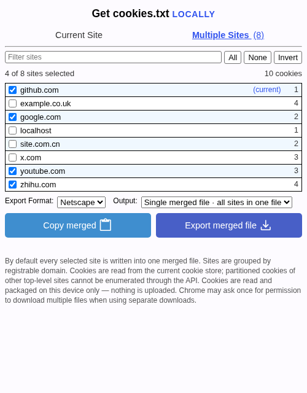

# Get cookies.txt LOCALLY — Multi-Site Fork

[中文说明](README.zh-CN.md)

A fork of [kairi003/Get-cookies.txt-Locally](https://github.com/kairi003/Get-cookies.txt-Locally) that keeps the original
"never sends anything outside" guarantee and adds **batch export for multiple sites at once**.

Cookies are still read with the `chrome.cookies` API and packaged entirely on your machine — there is no network code
anywhere in the extension.



## What is new compared with upstream

| Feature | Upstream | This fork |
| --- | --- | --- |
| Export current site (Netscape / JSON / Header) | ✅ | ✅ |
| Export every cookie in the profile | ✅ | ✅ |
| List all sites that have cookies | — | ✅ grouped by registrable domain |
| Select many sites and export together | — | ✅ |
| Search / select all / invert selection | — | ✅ |
| Output as one merged file | — | ✅ default |
| Output as a ZIP with one file per site | — | ✅ |
| Output as separate downloads | — | ✅ |
| Remember the last selection | — | ✅ |

Sites are grouped by base domain: cookies from `example.com`, `www.example.com` and `api.example.com` land in a single
`example.com` bucket, and two-label public suffixes such as `co.uk` or `com.cn` are handled, so `shop.example.co.uk`
is grouped under `example.co.uk` rather than `co.uk`.

## Install

### Prebuilt bundles

Chrome and Firefox ZIPs are attached automatically to
[GitHub Releases](https://github.com/Dremous/Get-cookies.txt-Locally-MultiExport/releases) by the `Release`
workflow whenever a `v*.*.*` tag is pushed.

### Load unpacked (Chrome / Edge / other Chromium browsers)

1. Download or clone this repository.
2. Open `chrome://extensions/` and enable **Developer mode**.
3. Click **Load unpacked** and select the `src` folder.

### Firefox

Build the Firefox bundle first (it merges `manifest-firefox.json` into the manifest), then load the unpacked folder
in `about:debugging#/runtime/this-firefox`:

```bash
npm install
npm run build:firefox
```

Unzip `dist/get-cookies.txt-locally_v*_firefox.zip` and select its `manifest.json` via **Load Temporary Add-on**.

## Usage

### Current site

The **Current Site** tab behaves exactly like upstream: it shows the cookies of the active tab in a table and offers
**Export**, **Export As**, **Copy** and **Export All Cookies**, with Netscape / JSON / Header String formats.

### Multiple sites

1. Open the **Multiple Sites** tab — it lists every site that has cookies in this browser profile, together with the
   cookie count and a `current` badge for the active site.
2. Pick sites individually, or use **All / None / Invert** together with the filter box.
3. Choose the format and the output mode:
   - **Single merged file (default)** — `cookies_all_<n>sites_<yyyymmdd>.<ext>`: every selected site goes into **one
     file**. With the Netscape format this is a single `cookies.txt` with one comment header per site, still valid for
     `wget`, `curl` and `MozillaCookieJar`.
   - **ZIP · one file per site** — `cookies_<n>sites_<yyyymmdd>.zip` containing one `<site>_cookies_<yyyymmdd>.<ext>`
     per site plus a `_sites.txt` index.
   - **Separate downloads** — one download per site.
4. Press **Export merged file**, or **Copy merged** to put the merged text on the clipboard.

The selection is stored in `localStorage`, so reopening the popup keeps your previous choice.

## Formats

- **Netscape** — the `cookies.txt` format accepted by `wget --load-cookies`, `curl -b`, Python `MozillaCookieJar` and
  yt-dlp.
- **JSON** — the raw `chrome.cookies.Cookie` array.
- **Header String** — `name=value; name=value;`, ready to paste into a `Cookie` request header. This format is
  single-site only; the multi-site panel does not offer it because one header cannot represent multiple domains.

## Permissions

Identical to upstream, and unchanged by the batch feature:

- **activeTab** — URL of the current tab.
- **cookies** — read and export cookies (never writes, never sends).
- **downloads** — save the generated files.
- **notifications** — update notice.
- **host permissions (`<all_urls>`)** — read cookies through the `chrome.cookies` API.

## Development

```bash
npm install
npm test              # node:test unit tests (site grouping, ZIP writer, batch export)
npm run check         # biome lint/format + version sync check
npm run build         # dist/*_chrome.zip and dist/*_firefox.zip
```

Layout:

```
src/
  popup.html            two-tab UI
  popup.mjs             single-site + batch wiring
  popup-batch.css       multi-site styles (light and dark)
  modules/
    cookie_format.mjs   Netscape / JSON / Header serializers (upstream)
    get_all_cookies.mjs cookie store + partition handling (upstream, + batch helper)
    save_to_file.mjs    download helper (upstream, now binary-capable)
    site_group.mjs      registrable-domain grouping
    batch_export.mjs    merged / per-site / ZIP payload builder
    zip_writer.mjs      dependency-free STORE-method ZIP writer
tests/                  node:test suites
```

## Notes and limits

- Cookies are read from the current cookie store. Partitioned cookies of the active tab are included; partitioned
  cookies belonging to *other* top-level sites are not enumerable through the API.
- "Separate downloads" triggers one download per site; Chrome may ask once whether the extension may download multiple
  files.
- The ZIP writer stores files without compression — cookie files are small and this keeps the code auditable.
- Firefox support follows upstream (background page for saving files).

## License

MIT, same as upstream. Original work © 2023 [kairi](https://github.com/kairi003); see [LICENSE](LICENSE).
