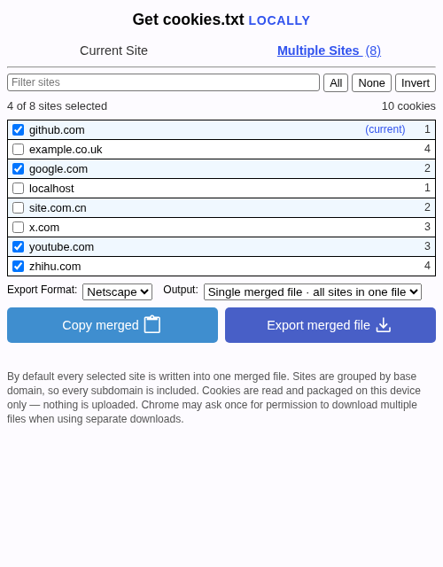

# Get cookies.txt LOCALLY · 多站点批量导出版

这是 [kairi003/Get-cookies.txt-Locally](https://github.com/kairi003/Get-cookies.txt-Locally) 的本地复刻版（MIT），
保留「数据绝不出本机」的原始承诺，并新增**多站点批量导出**。

所有 cookie 仍然只通过 `chrome.cookies` 读取，在本机打包；扩展里没有任何网络请求代码。



## 相比上游新增了什么

| 功能 | 上游 | 本复刻版 |
| --- | --- | --- |
| 导出当前站点（Netscape / JSON / Header） | ✅ | ✅ |
| 导出浏览器里的全部 cookie | ✅ | ✅ |
| 列出所有存有 cookie 的网站 | — | ✅ 按基础域名聚合 |
| 勾选多个网站一起导出 | — | ✅ |
| 搜索 / 全选 / 反选 | — | ✅ |
| 合并为一个文件 | — | ✅ 默认 |
| 每站一个文件并打包 ZIP | — | ✅ 零依赖 ZIP 写入器 |
| 逐站分别下载 | — | ✅ |
| 记住上次勾选 | — | ✅ |

站点按基础域名（registrable domain）聚合：`example.com`、`www.example.com`、`api.example.com` 的 cookie
都会归到 `example.com` 一个条目；`co.uk`、`com.cn` 这类二级公共后缀也做了处理，所以
`shop.example.co.uk` 会归到 `example.co.uk` 而不是 `co.uk`。

## 安装

### 直接下载

每次推送 `v*.*.*` 标签后，`Release` workflow 会自动构建并把 Chrome / Firefox 的 zip
上传到 [GitHub Releases](https://github.com/Dremous/Get-cookies.txt-Locally-MultiExport/releases)，可直接下载。

### Chrome / Edge 等 Chromium 浏览器（加载已解压的扩展）

1. 下载或克隆本仓库。
2. 打开 `chrome://extensions/`，开启「开发者模式」。
3. 点击「加载已解压的扩展程序」，选择 `src` 目录。

也可以直接使用 `dist/get-cookies.txt-locally_v0.8.0_chrome.zip` 解压后加载。

### Firefox

```bash
npm install
npm run build:firefox
```

把 `dist/get-cookies.txt-locally_v0.8.0_firefox.zip` 解压到一个文件夹，打开
`about:debugging#/runtime/this-firefox`，选择「临时载入附加组件」，选中解压目录里的 `manifest.json`。

## 使用

### 当前站点

「Current Site」标签与上游一致：表格展示当前标签页的 cookie，提供 **Export**、**Export As**、**Copy**、
**Export All Cookies**，支持 Netscape / JSON / Header String 三种格式。

### 多站点批量

1. 打开「Multiple Sites」标签，列表会显示当前浏览器配置里所有存有 cookie 的站点、cookie 数量，
   当前标签页对应的站点会带 `current` 标记。
2. 用复选框逐个选择，或用 **All / None / Invert** 配合上方过滤框批量操作。
3. 选择格式与输出方式：
   - **Single merged file（默认）** —— 生成 `cookies_all_<站点数>sites_<日期>.<扩展名>`：所有勾选站点写进**同一个
     文件**。Netscape 格式下就是一个 `cookies.txt`，按站点插入注释头，`wget`、`curl`、Python
     `MozillaCookieJar` 都能正常解析。
   - **ZIP · one file per site** —— 生成 `cookies_<站点数>sites_<日期>.zip`，内含每个站点一个
     `<站点>_cookies_<日期>.<扩展名>`，另附 `_sites.txt` 清单。
   - **Separate downloads** —— 每个站点单独下载一个文件。
4. 点击 **Export merged file**，或 **Copy merged** 把合并后的文本复制到剪贴板。

勾选结果保存在 `localStorage`，下次打开插件时自动恢复。

## 格式说明

- **Netscape** —— 标准 `cookies.txt`，适用于 `wget --load-cookies`、`curl -b`、`MozillaCookieJar`、yt-dlp 等。
- **JSON** —— `chrome.cookies.Cookie` 原始对象数组。
- **Header String** —— `name=value; name=value;`，可直接粘贴到 `Cookie` 请求头。该格式仅支持单站点导出；
  多站点面板不提供此选项，因为一个请求头无法区分多个域名。

## 权限

与上游完全一致，批量功能没有新增权限：

- **activeTab** —— 读取当前标签页 URL。
- **cookies** —— 读取并导出 cookie（不写入、不上传）。
- **downloads** —— 保存生成的文件。
- **notifications** —— 更新提示。
- **host permissions (`<all_urls>`)** —— 通过 `chrome.cookies` 读取 cookie。

## 开发与构建

```bash
npm install
npm test              # node:test 单元测试（域名聚合、ZIP 写入、批量导出）
npm run check         # biome 检查 + 版本一致性
npm run build         # 生成 dist/*_chrome.zip 与 dist/*_firefox.zip
```

目录结构：

```
src/
  popup.html            双标签界面
  popup.mjs             当前站点 + 批量导出逻辑
  popup-batch.css       多站点样式（含深色模式）
  modules/
    cookie_format.mjs   Netscape / JSON / Header 序列化（上游）
    get_all_cookies.mjs cookie store / 分区处理（上游 + 批量辅助函数）
    save_to_file.mjs    下载封装（上游，现支持二进制）
    site_group.mjs      基础域名聚合
    batch_export.mjs    合并 / 分站点 / ZIP 载荷构建
    zip_writer.mjs      零依赖 STORE 模式 ZIP 写入器
tests/                  node:test 测试
```

## 说明与限制

- cookie 取自当前 cookie store；当前标签页所属顶级站点的分区 cookie（CHIPS）会被包含，其他顶级站点的分区
  cookie 无法通过 API 枚举。
- 「Separate downloads」会逐站触发下载，Chrome 可能询问一次是否允许下载多个文件。
- ZIP 采用不压缩存储 —— cookie 文件很小，这样代码更简单、可审计。
- Firefox 支持沿用上游实现（由 background page 负责保存文件）。

## 许可证

MIT，与上游一致。原始作品 © 2023 [kairi](https://github.com/kairi003)，详见 [LICENSE](LICENSE)。
